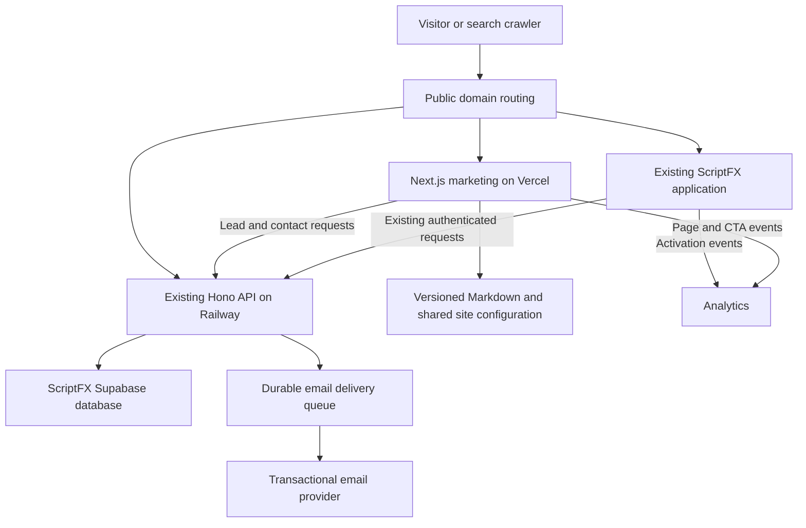

# ScriptFX marketing foundation: Slabfy audit and implementation plan

Reviewed October 6, 2026. Status: architecture proposal. The headline spacing and navigation logo fixes are implemented; the foundation work below is planned.

## Recommendation

Adopt Slabfy's separation of marketing, application, and backend, its reusable page shell, its feature and editorial pages, and its checks that keep public claims consistent with the product. Extend ScriptFX's existing application backend to serve marketing forms. Organize the landing story around the three product areas: Writing, Production, and Market. Keep the current cinematic identity and make the content usable before animations run.

The objective is to compete for searches such as “screenwriting software” and introduce visitors to the full Writing → Production → Market journey. Ranking first is an aspiration, not an engineering acceptance criterion. Google explicitly says that nobody can guarantee a number-one ranking. This audit did not access Slabfy's Search Console or analytics, so it cannot establish which changes caused Slabfy's reported ranking gains. [Google guidance](https://developers.google.com/search/docs/fundamentals/do-i-need-seo)

## Product story: Writing → Production → Market

Peter confirmed that Production and Market will be product tabs. They are primary parts of the landing-page narrative and navigation, alongside the writing experience.

| Chapter | Story responsibility | Planning requirement |
| --- | --- | --- |
| Writing | Start with the idea and develop the screenplay | Show the existing writing, revision and table-read experience |
| Production | Continue the project into production | Define the tab's actual workflow and demonstrate the handoff from Writing |
| Market | Continue the project into its market-facing stage | Define what Market lets users do before promising specific features or outcomes |

The homepage should introduce the whole journey in the hero, then follow one project through the three chapters. Each chapter needs a clear purpose, a product view, a transition to the next stage and a relevant destination. The closing CTA should reconnect all three. Smaller feature demonstrations sit within these chapters.

Use the same three areas in the site navigation, feature grouping and product availability manifest. The exact Production and Market capabilities and launch dates remain to be specified; their inclusion in the story does not establish that they are already shipping. Screenwriting remains an important search entry point, while the landing page explains the broader product.

For the application foundation, plan continuity around the existing project identity, membership and permissions as work moves between areas. Define cross-tab asset and status contracts when their workflows are specified. The marketing backend work below is still lead capture, contact and app entry; implementing Production or Market product services requires its own feature contracts.

## Verified reference checkouts

| Project | Checkout | State inspected |
| --- | --- | --- |
| ScriptFX marketing | `/Users/peterperezjr/ScriptFX Landing` | `main`, current with origin; existing uncommitted design work preserved |
| Slabfy marketing | `/Users/peterperezjr/Documents/Clients/Slabfy-2025/slabfy-landing` | `main`, `ed9cf5b`, current with origin |
| Slabfy app and API | `/Users/peterperezjr/Documents/Clients/Slabfy-2025/slabfy` | `main`, `4abe56388`, current with origin |
| ScriptFX app and API | `/Users/peterperezjr/Documents/Clients/ScriptfXV1/scriptfxv1` | `listen-rework`, `2d52a39`; existing untracked audio experiment preserved |

The older `/Users/peterperezjr/Slabfy Landing Page` checkout is four commits behind and has a local script edit. It was not used as the primary reference. The supplied `ScriptFX 2` workspace is not the landing page.

Slabfy's public homepage and blog were also read through the web tool. Direct HTTP inspection returned 403 responses, and the web tool could not retrieve its sitemap XML. Sitemap counts below describe the checked-out implementation, not a verified production XML response. No live form, email, account, database, or deployment was changed.

## What Slabfy actually has

| Layer | Slabfy implementation | ScriptFX equivalent to build |
| --- | --- | --- |
| Web stack | Next.js 16, React 19, TypeScript, Tailwind 4, GSAP | Already substantially the same stack; establish shared conventions |
| Site shell | Shared navigation, menu, floating CTA, reusable footer and typography components | Shared header, menu, footer, CTA, page containers, and explicit typography tokens across every public page |
| Homepage | Hero, problem/operator section, one pinned story stage, feature grid, closing CTA and footer | Tell the Writing → Production → Market story using the same section responsibilities |
| Motion loading | Heavy stage dynamically loaded after the initial hero; native scrolling on mobile | Make the initial message and CTA usable immediately; defer heavy below-fold motion |
| Search identity | Site URL, title templates, descriptions, canonical URLs, Open Graph, social images, icons, robot directives | Typed site configuration and per-page metadata with ScriptFX's real positioning |
| Crawl discovery | `robots.txt`, generated sitemap, previews marked `noindex` | Sitemap generated from published routes and posts; previews and account routes excluded |
| Feature pages | Six feature routes in the sitemap, with explanatory text, cross-links, CTAs and metadata | Group demonstrated workflows under Writing, Production and Market, with clear availability |
| Editorial system | 39 Markdown posts, static rendering, date filtering, cover images, reading time and updated dates | Validated content metadata, useful screenwriting guides, accurate dates and a reliable publishing process |
| Article shell | Author, table of contents, related posts, inline/end CTA, sticky CTA and exit modal | Same reusable article shell; start with inline/end CTA, then evaluate sticky and exit experiences |
| Structured data | Organization, WebSite, SoftwareApplication, Article and BreadcrumbList; also older FAQ markup | Generate supported, truthful markup from the same data used on the page |
| Trust pages | About, FAQ, contact, terms and privacy | ScriptFX-specific company, support, ownership, privacy and terms content |
| Forms | Landing contact form posts to the main app's API | Real saved submissions, validation, retry handling and honest success states |
| Admission flow | Current waitlist links redirect into app onboarding; backend supports verification, referrals, status and account binding | One launch flow, with optional verification, invitations and referrals after the basic funnel works |
| Analytics | GA4 plus optional GTM and advertising pixels; named CTA, pricing and blog events | ScriptFX-specific measurement IDs and a clear visitor-to-activation funnel |
| Deployment | Cloudflare routes marketing to Vercel and application/API traffic to Railway | Explicit routing between the marketing deployment, existing app and existing API |
| Reliability | Security/cache headers, error pages, scheduled redeploy, public pricing checks and plan-registry drift checks | Build, route, content, form and public-claim checks before release |
| Secondary surfaces | `llms.txt`, `llms-full.txt`, app-origin-aware links and an iOS reading context | Optional generated text summaries; in-app shell only if ScriptFX needs it |

The source sitemap currently constructs 54 URLs: 8 general entries, 6 features, the blog index, and 39 posts. This is evidence of the site's breadth, not a target number for ScriptFX.

Primary source locations:

- [Slabfy root layout](</Users/peterperezjr/Documents/Clients/Slabfy-2025/slabfy-landing/src/app/layout.tsx>), [homepage composition](</Users/peterperezjr/Documents/Clients/Slabfy-2025/slabfy-landing/src/app/v4/Landing.tsx>), [footer](</Users/peterperezjr/Documents/Clients/Slabfy-2025/slabfy-landing/src/components/landing/site-footer.tsx>).
- [Content loader](</Users/peterperezjr/Documents/Clients/Slabfy-2025/slabfy-landing/src/lib/blog.ts>), [article template](</Users/peterperezjr/Documents/Clients/Slabfy-2025/slabfy-landing/src/components/blog/blog-post.tsx>), [article metadata](</Users/peterperezjr/Documents/Clients/Slabfy-2025/slabfy-landing/src/app/blog/[slug]/page.tsx>), [sitemap](</Users/peterperezjr/Documents/Clients/Slabfy-2025/slabfy-landing/src/app/sitemap.ts>).
- [Hosting configuration](</Users/peterperezjr/Documents/Clients/Slabfy-2025/slabfy-landing/next.config.ts>), [edge router](</Users/peterperezjr/Documents/Clients/Slabfy-2025/slabfy/cloudflare/router/src/index.ts>), [contact API](</Users/peterperezjr/Documents/Clients/Slabfy-2025/slabfy/server/routes/contact-form.ts>), [waitlist API](</Users/peterperezjr/Documents/Clients/Slabfy-2025/slabfy/server/routes/waitlist.ts>).

## ScriptFX's current gaps

| Priority | Verified finding | Required outcome |
| --- | --- | --- |
| P0 | Production build compiles assets but fails TypeScript on an old component's missing `features-section` import | A clean production build; review the duplicate component tree and repair references deliberately |
| P0 | Footer waitlist submission waits one second and shows success; it makes no request | Show success only after the backend durably accepts the submission |
| P0 | `/get-access` and `/sign-in` contain placeholder text | Working links to the chosen signup/waitlist and existing login flow |
| P0 | Menu and footer link to missing `/technology` and `/careers` routes | Every published link resolves; publish real pages or omit unavailable destinations |
| P0 | Root description describes generic automation, not screenwriting; no sitemap or robots file found | Correct product identity and crawl controls before production launch |
| P1 | Pricing is sample data for automation workspaces; buttons return to `/` | Public pricing and entitlement claims derived from the actual product's approved source |
| P1 | One starter blog post; basic article metadata; dynamic route still uses synchronous `params` | A working Next.js 16 article route, complete article shell and useful content |
| P1 | Hero starts with `opacity-0`; screenplay and footer rely on scroll animation; a reduced-motion value is read but unused in the screenplay orchestrator | Readable content and a usable CTA with JavaScript unavailable or reduced motion enabled |
| P1 | Footer is embedded in the animated homepage | A reusable footer available on feature, blog, trust and conversion pages |
| P1 | Demo copy includes “Launching Q1 2026” and content placeholders | Accurate launch state and real product examples |
| P1 | No landing analytics or marketing API route implementations found | Track CTA, accepted lead/signup and product activation separately |
| P2 | Experimental fonts and the typography picker load globally | Keep the design control during review; put it behind a development flag for production and load the selected font only |

Source evidence: [layout](</Users/peterperezjr/ScriptFX Landing/src/app/layout.tsx>), [footer submission](</Users/peterperezjr/ScriptFX Landing/src/components/home/footer/footer-section.tsx:130>), [access placeholder](</Users/peterperezjr/ScriptFX Landing/src/components/get-access/get-access.tsx>), [pricing](</Users/peterperezjr/ScriptFX Landing/src/components/pricing/pricing.tsx>), [menu](</Users/peterperezjr/ScriptFX Landing/src/components/nav/top-nav-menu.tsx>), [hero](</Users/peterperezjr/ScriptFX Landing/src/components/home/home-hero.tsx>), [screenplay orchestration](</Users/peterperezjr/ScriptFX Landing/src/components/home/screenplay/screenplay-section.tsx>), [blog route](</Users/peterperezjr/ScriptFX Landing/src/app/blog/[slug]/page.tsx>).

Client components can still produce server-rendered HTML. The issue to fix is hidden, animation-dependent content and incomplete routes; the `use client` directive alone does not establish an indexing failure. [Google's JavaScript guidance](https://developers.google.com/search/docs/crawling-indexing/javascript/javascript-seo-basics)

## Architecture and ownership

ScriptFX already has a React/Vite application, a Hono API, Supabase authentication and storage, billing routes, and Railway API/worker configuration. Preserve those investments. Slabfy uses Express/Drizzle for its app backend; changing ScriptFX to that framework would be a separate product migration with little direct SEO benefit.



Use Slabfy's same-domain router pattern when the public domain is selected. Marketing routes and assets go to Next.js; application routes go to the existing application; `/api/*` goes to Hono. Match path boundaries, preserve query strings, forward the original host/protocol safely, and avoid caching authenticated responses. Keep API and worker health checks at ScriptFX's existing `/health` path. A separate app subdomain remains an option if deployment simplicity is preferred; it requires deliberate authentication and attribution handling.

Create one route inventory and test both the site links and edge routing against it. Define canonical host, trailing slash policy, redirects, and app URL in configuration. Avoid self-redirects and API proxy loops when public and upstream domains differ.

Recommended marketing organization:

```text
src/app/                       Routes, server metadata, sitemap and robots
src/components/site/           Header, menu, footer, CTA and containers
src/components/home/           ScriptFX story and scoped motion
src/components/features/       Shared feature-page template
src/components/blog/           Index, article, contents and related links
src/components/forms/          Waitlist and contact UI
src/lib/site/                  Site identity, route registry and feature claims
src/lib/seo/                   Metadata and JSON-LD builders
src/lib/content/               Validated content loader and publication dates
src/lib/analytics/             Typed events and consent-aware adapters
content/blog/                  Reviewed editorial content
```

Keep route files thin, use server rendering for public text, and isolate interactive controls and GSAP in client components. Use shared heading/body components or scoped tokens rather than broad selectors on every `span`, link and input. Manrope stays at 600 / +0.08rem for headings and 500 / 0em for supporting text; screenplay samples retain Courier New.

## Backend contract

Add marketing routes within ScriptFX's existing backend, following its existing response/error and validation conventions. Public routes must mount before the blanket `/api/*` authentication middleware. Existing private project, screenplay, audio and billing routes remain authenticated.

| Proposed endpoint | Purpose | Required behavior |
| --- | --- | --- |
| `POST /api/public/marketing/leads` | Waitlist or product-interest signup | Validate and normalize email; deduplicate in the database; store attribution and subscription choice; return an honest accepted state |
| `POST /api/public/marketing/leads/verify` | Confirm email ownership if the chosen launch flow needs it | Expiring, hashed, single-use token; use POST so email scanners cannot confirm by merely fetching a link |
| `POST /api/public/marketing/contact` | Support, partnership and press inquiries | Bounded fields, durable save, rate limiting and notification retry |
| Existing application login/signup routes | Account creation and returning users | Reuse Supabase identity; validate redirect destinations and preserve allowed campaign parameters |
| Protected admin endpoints | Review, export and update leads/contact submissions | Staff authorization and an audit trail; no public access to contact lists |

Proposed data:

- `marketing_leads`: ID, normalized unique email, optional name, status, source page, allowlisted UTM fields, marketing preference and timestamp, created/updated/verified timestamps. Store verification tokens as hashes.
- `contact_submissions`: ID, optional name/company, email, validated category, bounded message, source, status and timestamps.
- `email_outbox`: event type, submission ID, deduplication key, delivery status, attempt count and next retry time. Reuse an existing equivalent if available when implementing.

Persist the lead or inquiry and its email event atomically. Email-provider failure must not lose a saved lead. Prevent duplicate notification sends on retries. Enforce limits across instances, validate origins for browser submissions, add an inexpensive bot trap, and escalate bot controls only when needed. New tables require migrations and row-level access rules; public clients must not read the lead tables. Logs and analytics must exclude email addresses, message contents, tokens and screenplay text.

Slabfy also supports referrals, phone verification and admission/account binding. Include these in a later parity phase only if the launch uses invitation-based admission. The initial foundation does not require copying its card-hobby-specific referral mechanics.

## Public site and content plan

Let `/` introduce all three product areas while addressing the broad “screenwriting software” entry intent. Avoid a second near-identical `/screenwriting-software` page. Production and Market should have distinct supporting pages once their workflows and availability are defined. Their content should answer different visitor needs and link back to the full product journey.

| Page or family | Visitor need | Content required before indexing |
| --- | --- | --- |
| `/` | Understand the full ScriptFX journey and decide whether to try it | Clear positioning, Writing → Production → Market chapters, connected product demonstration, availability, proof and primary CTA |
| `/production` | Understand the Production tab and its connection to the screenplay | Defined workflow, actual product demonstration, inputs from Writing and clear availability |
| `/market` | Understand the Market tab and what comes after production | Defined Market workflow, product demonstration, requirements and clear availability |
| `/features/screenplay-editor` | Write and format a screenplay | Actual editor screenshots, formatting examples, supported imports/exports and limitations |
| `/features/table-read` | Hear a script performed | Real sample with transcript, casting workflow, supported output and honest limits |
| `/features/character-voices` | Cast distinct character voices | Demonstrated voice assignment and control; explain capabilities that are actually available |
| `/features/revisions` | Revise and compare scenes | Verified revision workflow and recovery behavior |
| `/features/collaboration` | Work with other writers | Publish once the shipping collaboration workflow has been verified end to end |
| `/pricing` | Understand cost and limits | Approved plans, billing period, usage limits, trial terms and a working destination |
| `/blog` and `/blog/[slug]` | Learn, solve a problem or evaluate tools | Useful original examples, author, dates, images, contents, related links and a relevant CTA |
| `/compare/[competitor]` | Evaluate an alternative | Firsthand comparison, date checked, links to primary sources and accurate trade-offs |
| `/templates` and a first useful tool | Start writing with less effort | Original downloadable screenplay template; later a genuinely useful local calculator or formatter |
| `/about`, `/faq`, `/contact` | Establish trust and get help | Actual team, product story, support process, ownership and AI-use explanations |
| `/privacy`, `/terms` | Understand product terms | Product-specific text reviewed for the actual data and service flows |
| `/get-access`, `/sign-in` | Enter the product | Chosen waitlist/signup behavior and redirect to the existing login route |

The feature list is a planning inventory. Source files establish that ScriptFX has editor, table-read, voice, revision and collaboration code; they do not establish that every capability is ready to advertise. Production and Market are confirmed product areas with details still to be specified. Maintain a shared feature manifest with product area (`writing`, `production`, or `market`), availability status, plan eligibility and proof/demo links, and gate public copy on it.

Suggested first editorial batch: screenplay formatting with an original annotated page; dialogue formatting; preparing a table read; revising dialogue by listening; moving from outline to scenes; supported import/export workflows; a tested Final Draft alternative comparison; and a guide comparing online screenwriting workflows. These are proposed topics, not measured search-volume findings.

The market includes broad software evaluation as well as learning intent. Final Draft's public site combines product pages, education, templates, trials and customer proof; Celtx combines writing with production workflows. Use real ScriptFX examples to explain its particular advantage. Do not publish undemonstrated video-generation or “free software” claims merely to target a keyword. [Final Draft](https://www.finaldraft.com/) · [Celtx](https://www.celtx.com/)

For each article, validate title, slug, description, author, publish/update dates, cover image/alt text, topic and CTA target. Generate table-of-contents IDs from the same parser as the article. Choose related posts by topic. Date changes must represent meaningful edits. With static publishing, use a scheduled redeploy or a supported revalidation mechanism, and verify that a scheduled post appears after publication.

## Search, performance and measurement

Every indexable page needs useful rendered text, a distinct title and description, a canonical URL, working internal links and truthful social metadata. Generate the sitemap from published canonical routes; exclude redirects, private pages, drafts and previews. Unknown routes must return a real 404. Use `noindex` where appropriate; a robots exclusion alone is not a substitute for access control or an indexing directive.

Use Organization/WebSite data for site identity and Article/BreadcrumbList on the applicable pages. SoftwareApplication data must describe the real app and available offer. Google's software rich-result eligibility also requires genuine rating or review data; do not fabricate it or promise rich-result eligibility before the required evidence exists. [Software application documentation](https://developers.google.com/search/docs/appearance/structured-data/software-app)

Keep FAQ content for readers. Google's changelog says FAQ rich results stopped appearing on May 7, 2026, so copying Slabfy's FAQ schema is not a current Google search enhancement. Google also says `llms.txt` does not positively or negatively affect its rankings, and the keywords meta tag is unused. These are low-priority or unnecessary items, regardless of their presence in Slabfy. [Google updates](https://developers.google.com/search/updates) · [SEO starter guide](https://developers.google.com/search/docs/fundamentals/seo-starter-guide)

Performance targets are LCP at or below 2.5 seconds, INP at or below 200 milliseconds and CLS at or below 0.1, assessed with field data when enough traffic exists. Use production mobile tests before launch. Optimize the hero image and font delivery; defer below-fold media, heavy motion and optional trackers; keep image dimensions explicit. Reduced-motion mode should provide a compact reading layout with all links and CTAs accessible. [Core Web Vitals](https://developers.google.com/search/docs/appearance/core-web-vitals)

Set up ScriptFX's own Search Console property and sitemap submission, Bing verification if desired, and its own analytics property. Record page/CTA events, accepted leads or completed signup, and a meaningful activation such as first screenplay creation or first completed table read. A click is not a signup. Review search clicks/impressions by page and query alongside conversion and activation rates. Compare with Slabfy's last 3–6 months of Search Console and conversion data once access is available; code alone cannot establish attribution.

Support organic discovery with original demonstrations, founder explanations, real writer case studies, templates and relevant writing communities or educators. Outreach and publication require a separate execution step. A technically correct site provides eligibility and usability; useful content and credible external recognition remain part of the growth work. [Google Search Essentials](https://developers.google.com/search/docs/essentials)

## Improvements to make while adapting Slabfy

1. **Route ownership:** Slabfy has a `/price-check` marketing page, but that path is missing from the inspected edge router's landing route set. The public web fetch returned the generic app title and no readable page text. This suggests a routing gap; production router configuration was not independently inspected. Test route ownership automatically in ScriptFX.
2. **One publication date source:** Slabfy's sitemap uses a fixed fallback date and article `date`, while Article JSON-LD can use `lastUpdated` and Open Graph still uses `date`. Generate all modification dates from a single content field.
3. **Form contract parity:** Slabfy's old landing waitlist form allows an omitted name, while the current backend requires one. Its contact form also offers a category absent from the backend enum. Current onboarding redirects bypass the old waitlist page, but copied forms would inherit these mismatches. Share schemas or test request contracts.
4. **Accurate conversion events:** Slabfy's blog click helper can emit advertising “Lead” events on a CTA click. ScriptFX should count a completed lead only after backend acceptance.
5. **Reliable enforcement:** Slabfy's contact limiter uses process memory, and its plan-registry CI comparison can skip when the server repository is unavailable. Use shared rate-limit storage for multiple instances and require the applicable contract check on production releases.

These findings are reasons to adapt the reference carefully. No Slabfy fixes were made as part of this request.

## Build sequence and completion criteria

| Phase | Work | Completion gate |
| --- | --- | --- |
| 0. Baseline | Repair existing build/lint blockers; inventory duplicates without deleting unrelated work; define the three-area story and tab scope; confirm domain, deployment and launch mode | Production build and lint pass; Writing/Production/Market scope, route inventory and feature claims agreed |
| 1. Shared shell and search | Extract shared shell with Writing/Production/Market navigation; implement site config, page metadata, sitemap, robots, social image and error pages; make the three-chapter homepage resilient to motion/JS limitations | Public links resolve; the full product journey is clear; rendered HTML has meaningful text; mobile keyboard/reduced-motion check passes; initial production performance baseline recorded |
| 2. Conversion backend | Wire lead/contact endpoints, migrations, access rules, retryable email delivery and real app entry | Valid, invalid, repeated and rate-limited requests behave correctly; saved records survive email failure; private data cannot be read anonymously |
| 3. Page and editorial parity | Build feature/trust/article templates, approved pricing, first feature pages and first editorial batch; add attribution | Each page has unique metadata, relevant internal links and a working CTA; content and product claims pass validation |
| 4. Release and discovery | Deploy reviewed changes, verify canonical routing and index controls, submit sitemap, validate supported structured data and measure conversions | Production smoke checks pass; Search Console can inspect target pages; confirmed signup/activation events arrive correctly |
| 5. Iteration and optional parity | Expand comparisons/templates, improve pages using query data, add referrals/admin workflows or additional CTA placements when justified | Decisions tied to observed search, activation and reliability data |

Decisions needed before production configuration: the specific Production and Market workflows and their availability, the public domain, waitlist versus open signup, approved feature/plan availability, team/support identity and sender domain, and access to ScriptFX and Slabfy measurement properties. Local shell and build work can proceed before these are settled.

## Verification performed for this request

- Changed the Manrope default headline spacing and root token to **+0.08rem**, and updated the saved browser selection. Body settings remain 500 / 0em.
- Removed cursor tilt from the shared navigation logo and gave the image an explicit block layout with intrinsic aspect ratio. Browser measurement placed the image center at 47.992px and the navigation center at 48px; its transform was `none`.
- Browser computed headline spacing was **1.28px**, equivalent to 0.08rem at the current 16px root size. A screenshot was captured after the final change.
- Focused ESLint for the two changed TSX files and `git diff --check` passed.
- Full landing lint ran once: 3 existing unescaped-apostrophe errors and 15 warnings. Production build ran once: asset compilation passed, then TypeScript stopped at `src/app/_components/home/stacking-finale/stacking-finale.tsx:9` because `@/app/_components/home/features-section` is missing.
- The local server was restarted on `http://127.0.0.1:3000/` and returned HTTP 200. This audit did not run the Slabfy or ScriptFX product test suites, test provider delivery, verify field performance, or inspect live search analytics.
